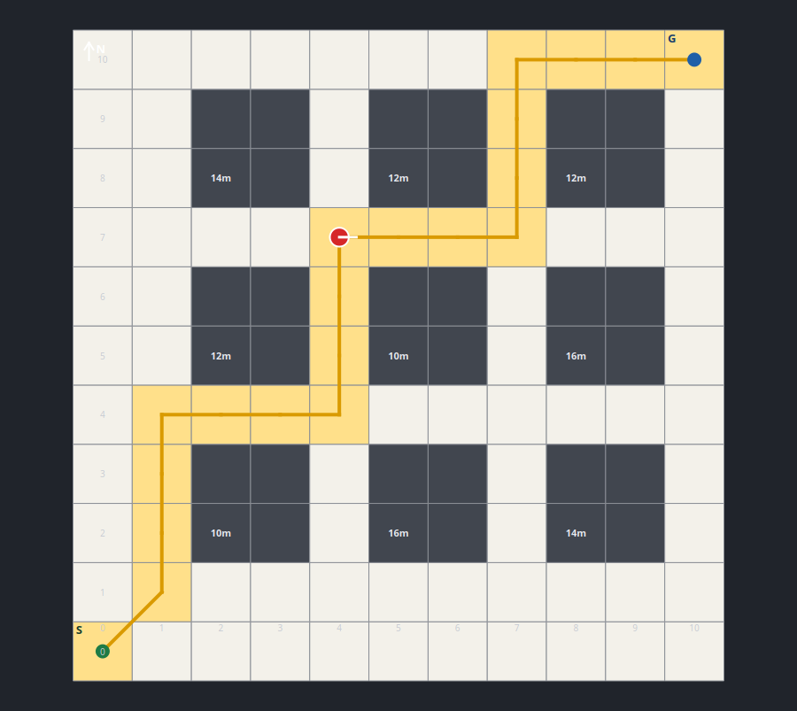
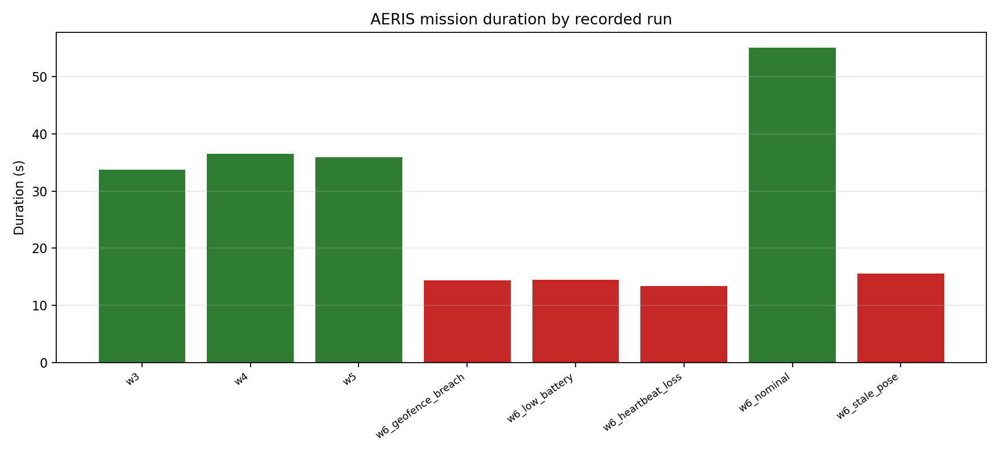

<div align="center">

# AERIS

### Autonomous UAV Inspection & Reliability System

A simulated industrial-inspection drone built with **PX4**, **ROS 2 Jazzy**, and **Gazebo Harmonic** — with mission autonomy, camera perception, lidar obstacle avoidance, safety supervision, and a click-to-fly city-grid planner.

[](https://docs.ros.org/en/jazzy/)
[](https://github.com/PX4/PX4-Autopilot)
[](https://gazebosim.org/)
[](docs/evaluation.md)
[](LICENSE)

[](docs/experiments/plots/grid_gui_spread.png)

*Click a free cell. AERIS plans the shortest free path, flies around the buildings, returns to the start cell, and lands.*

</div>

---

## Overview

AERIS is a reproducible robotics software project, not a collection of demo scripts. It pins its flight stack, separates flight control from mission autonomy, records every run as structured JSONL, and validates each layer in simulation.

The architecture follows one rule: **PX4 remains the only component that commands actuators.** ROS 2 owns mission state, planning, perception and safety supervision, and talks to PX4 over uXRCE-DDS.

The current build includes:

- 20 Hz offboard position control: arm, takeoff, hold, transit, RTL and land.
- A YAML-driven mission manager with validation, waypoint sequencing and JSONL logs.
- Downward-camera red-target detection using OpenCV.
- 270° lidar obstacle detection with a reactive lateral replan.
- An independent safety supervisor with injectable faults and deterministic land/RTL actions.
- A city-grid planner using 8-connected A* with no corner cutting.
- A PyQt5 GUI for click-to-goal selection and live drone/path/progress display.
- 46 automated tests and 20 environment checks.

## Highlights

| Capability | What it does |
|---|---|
| **Flight control** | 20 Hz offboard stream, mode/arm sequencing, takeoff ramp, position hold, RTL, landing, abort |
| **Mission autonomy** | YAML missions, altitude/geofence validation, waypoint sequencing, inspection holds, RTL, JSONL |
| **Perception** | Gazebo camera bridge, OpenCV red-panel detection, bearing/range/ground projection |
| **Obstacle avoidance** | 270° lidar sector map, corridor check, lateral detour, then original waypoint |
| **Safety** | Pose, battery, geofence and mission-heartbeat monitors; injected faults; land/RTL/hold actions |
| **City grid** | Occupancy map, A* shortest path, go-to-goal, return-to-start, repeat goals, PyQt5 GUI |
| **Observability** | JSONL mission logs, benchmark JSON/CSV, plots, structured console evidence |

## Architecture

```text
                    Gazebo Harmonic / X500
                             │ sensors
                             ▼
                    PX4 Autopilot
        EKF2 → position controller → attitude controller → actuators
                             │ uXRCE-DDS
                             ▼
                       ROS 2 Jazzy
  ┌──────────────────────────────────────────────────────────────┐
  │ aeris_flight_control   C++   PX4 interface + offboard control │
  │ aeris_mission_manager  Py    mission state + JSONL logging    │
  │ aeris_perception       Py    camera + OpenCV detection        │
  │ aeris_navigation       C++   lidar obstacles + corridor check │
  │ aeris_safety           C++   health monitor + safe actions    │
  │ aeris_grid_navigation  Py    occupancy grid + A* executor     │
  │ aeris_grid_gui         PyQt5 click-to-goal + live display     │
  │ aeris_bringup          Py    launch files + configuration     │
  └──────────────────────────────────────────────────────────────┘
```

**Design rules**

1. PX4 is the only component that commands actuators.
2. ROS 2 sends high-level goals and setpoints, never motor outputs.
3. Every external dependency is pinned and documented.
4. Every flight behavior has a scripted acceptance test.
5. Run artifacts and measurement results are first-class project files.

## City-grid GUI

The default city is an **11 × 11 grid** with 4 m cells and **nine evenly spaced 2 × 2 buildings** (36 occupied cells, 85 free). The drone starts at `(0,0)`, the south-west corner.

- **A\*** uses 8-connected moves, Euclidean heuristic, and blocks diagonal corner cutting.
- Clicking a free cell plans the shortest free path in real time.
- The GUI draws buildings, heights, start/goal, the path, the live drone pose, progress and safety state.
- The drone takes off, follows the path, holds at the goal, plans the return path, lands and disarms.
- Repeated goals work without restarting the stack.
- The goal is also available as a ROS service for headless use.

```bash
ros2 service call /aeris_grid_navigation/set_goal \
  aeris_interfaces/srv/GridGoal "{x: 10, y: 10}"
```

See [docs/grid_navigation.md](docs/grid_navigation.md) for the map schema, planner details, GUI behavior and evidence.

## Verification

### Flight scenarios

| Scenario | Result |
|---|---|
| Nominal inspection mission | 2/2 waypoints, 3 s holds, RTL, land, `COMPLETE` in ~33.8 s |
| Perception mission | 2/2 targets detected, confidence 1.00, range ~6.3 m |
| Obstacle mission | 3.75 m obstacle, one lateral replan to `(1.54, 1.94)`, original waypoint reached |
| Safety campaign | 4/4 injected faults produced the correct land/RTL action and a disarmed vehicle |
| Safety decision latency | 41–98 ms from fault injection to action dispatch |
| Grid missions (dense map) | 3/3 completed, including a repeat goal after `DONE`; 2.269 m minimum flight clearance |
| Default spread-map planner | 5/5 paths free, worst path clearance 2.500 m |

### Quality gates

| Gate | Result |
|---|---|
| ROS package tests | **42/42** |
| Evaluator tests | **4/4** |
| Total automated tests | **46 passing** |
| Environment checks | **20 ok, 0 warnings** |
| Build | 10 packages |



Benchmark details, methodology and limitations: [docs/evaluation.md](docs/evaluation.md).

## Packages

| Package | Language | Responsibility |
|---|---|---|
| `aeris_interfaces` | ROS 2 msgs/srvs | Flight, mission, safety, detection, obstacle, grid and goal interfaces |
| `aeris_flight_control` | C++ | PX4 telemetry, offboard stream, mode/arm/takeoff/goal/RTL/land |
| `aeris_mission_manager` | Python | Mission validation, state machine, replanning, safety aborts, JSONL |
| `aeris_perception` | Python | Camera bridge, OpenCV detection, target localization |
| `aeris_navigation` | C++ | Lidar scan analysis, sector obstacles, corridor status |
| `aeris_safety` | C++ | Pose/battery/geofence/heartbeat monitors, fault injection, safe actions |
| `aeris_grid_navigation` | Python | Occupancy grid, A* shortest path, go-to-goal/return execution |
| `aeris_grid_gui` | Python + PyQt5 | Goal selection and live path/drone/progress display |
| `aeris_bringup` | Python | Launch files, YAML configuration, missions and grid maps |

`px4_msgs` is an external submodule pinned to PX4 `v1.17.0`.

## Quick start

### Prerequisites

- Ubuntu/Pop!_OS 24.04
- ROS 2 Jazzy
- PX4-Autopilot `v1.17.0`
- Gazebo Harmonic
- QGroundControl
- Python 3.12

The full bootstrap script installs the system toolchain, PX4, Gazebo and the Micro XRCE-DDS Agent:

```bash
git clone --recursive https://github.com/Nikhil-URG/aeris-uav.git
cd aeris-uav
bash scripts/setup.sh
source scripts/aeris_env.sh
bash scripts/check_environment.sh
```

QGroundControl is optional to install but required for arming in this SITL setup:

```bash
bash scripts/install_qgroundcontrol.sh
scripts/run_qgroundcontrol.sh
```

### City-grid demo

```bash
# Terminal A — lightweight airframe, no camera
source scripts/aeris_env.sh
PX4_SIM_MODEL=gz_x500 bash scripts/launch_simulation.sh

# Terminal B — spawn the spread-out city
source scripts/aeris_env.sh
bash scripts/spawn_grid.sh

# Terminal C — stack + GUI
source scripts/aeris_env.sh
ros2 launch aeris_bringup grid_demo.launch.py
```

Click a free cell in the GUI. For headless operation:

```bash
ros2 launch aeris_bringup grid_navigation.launch.py
ros2 service call /aeris_grid_navigation/set_goal \
  aeris_interfaces/srv/GridGoal "{x: 10, y: 10}"
```

### Inspection mission demo

```bash
# Terminal A — camera airframe
source scripts/aeris_env.sh
PX4_SIM_MODEL=gz_x500_mono_cam_down bash scripts/launch_simulation.sh
bash scripts/spawn_targets.sh

# Terminal B — camera bridge + perception
ros2 launch aeris_bringup perception.launch.py

# Terminal C — mission stack
ros2 launch aeris_bringup mission.launch.py

# Terminal D — start
ros2 service call /aeris_mission_manager/start std_srvs/srv/Trigger
```

The default mission takes off, visits two inspection waypoints, records target detections, returns to launch and lands. See [docs/demo.md](docs/demo.md) for the full runbook and safety demo.

> **Simulation note:** use `gz_x500` for the city-grid demo. The camera + large city world caused the Gazebo server to crash during a long flight in this environment; the grid demo does not need the camera.

## Repository layout

```text
.
├── README.md
├── LICENSE
├── docs/
│   ├── architecture.md          # layers, frames, interfaces, ADRs
│   ├── installation.md          # setup + troubleshooting
│   ├── flight_control.md        # offboard contract and results
│   ├── mission_design.md        # mission schema and state machine
│   ├── perception.md            # camera + OpenCV
│   ├── navigation.md            # lidar + reactive replan
│   ├── safety.md                # supervisor, faults, failsafes
│   ├── grid_navigation.md       # city grid, A*, GUI
│   ├── evaluation.md            # benchmarks, metrics, limitations
│   ├── demo.md                  # demo runbook + video storyboard
│   ├── checkpoint.md            # portable handoff
│   └── experiments/             # JSONL logs, plots, evidence
├── ros2_ws/src/
│   ├── aeris_interfaces/
│   ├── aeris_flight_control/
│   ├── aeris_mission_manager/
│   ├── aeris_perception/
│   ├── aeris_navigation/
│   ├── aeris_safety/
│   ├── aeris_grid_navigation/
│   ├── aeris_grid_gui/
│   ├── aeris_bringup/
│   └── px4_msgs/                # submodule, PX4 v1.17.0
├── simulation/
│   ├── models/                  # inspection target, obstacle
│   ├── worlds/
│   └── scenarios/
├── scripts/                     # setup, build, launch, spawn, evaluate
├── tests/                       # evaluator tests
└── results/                     # ignored runtime logs/plots/reports
```

## Documentation

| Document | Contents |
|---|---|
| [docs/architecture.md](docs/architecture.md) | Layer boundaries, coordinate frames, interfaces, ADRs |
| [docs/installation.md](docs/installation.md) | Full setup, dependencies, troubleshooting |
| [docs/flight_control.md](docs/flight_control.md) | Offboard controller state machine and services |
| [docs/mission_design.md](docs/mission_design.md) | Mission schema, validation, state machine |
| [docs/perception.md](docs/perception.md) | Camera bridge, detector, localization |
| [docs/navigation.md](docs/navigation.md) | Lidar obstacles, corridor check, detour |
| [docs/safety.md](docs/safety.md) | Safety supervisor, fault injection, safe actions |
| [docs/grid_navigation.md](docs/grid_navigation.md) | City grid, A*, GUI and evidence |
| [docs/evaluation.md](docs/evaluation.md) | Benchmarks, metrics, plots, validity threats |
| [docs/demo.md](docs/demo.md) | Terminal-by-terminal demo and video storyboard |
| [docs/checkpoint.md](docs/checkpoint.md) | Portable project handoff and resume prompt |

## Engineering notes

- **Pinned stack:** PX4 `v1.17.0`, `px4_msgs` `v1.17.0`, Gazebo `8.15.0`, uXRCE-DDS Agent `v2.4.3`, QGC `5.1.5`.
- **Conda isolation:** `scripts/aeris_env.sh` keeps conda's Python 3.13 out of the ROS shell and sets `PYTHONNOUSERSITE=1` so apt OpenCV/NumPy work.
- **Simulation battery:** `launch_simulation.sh` keeps the SITL battery healthy for deterministic test campaigns; safety battery faults are injected in ROS.
- **No actuator shortcuts:** every autonomous action goes through `aeris_flight_control`.
- **Evidence first:** each run writes JSONL; the evaluator produces reproducible JSON/CSV/plots.

## Limitations

- Simulation only; no hardware flight is claimed.
- Perception localization is approximate (nadir-camera ground projection).
- The grid is 2D and static; buildings are axis-aligned blocks.
- Benchmark results are representative runs, not a Monte Carlo study.
- The camera + city world was unstable in this environment; the grid demo uses the camera-less airframe.
- The demo video is not checked in; the runbook and storyboard are.

## Project status

| Milestone | Status |
|---|---|
| Week 1 — PX4, Gazebo, ROS 2 telemetry | Complete |
| Week 2 — offboard flight | Complete |
| Week 3 — mission manager | Complete |
| Week 4 — camera perception | Complete |
| Week 5 — lidar obstacle avoidance | Complete |
| Week 6 — safety and failsafes | Complete |
| Week 7 — evaluation and demo | Complete |
| Extension — city grid, A*, GUI | Complete |

## License

Apache 2.0. See [LICENSE](LICENSE).

---

<div align="center">

**AERIS** — built as a reproducible PX4 + ROS 2 autonomy portfolio project.

</div>
