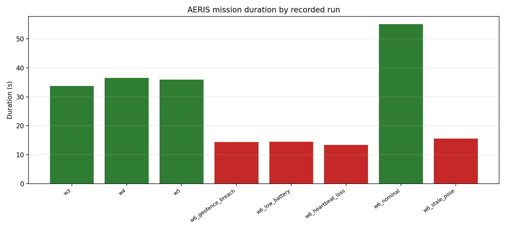
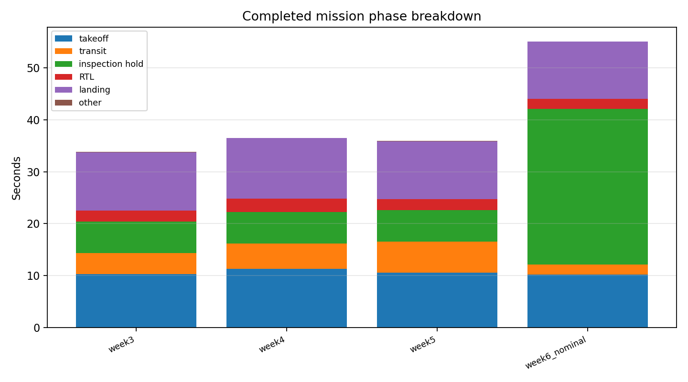

# Evaluation and Benchmarks

This document closes the AERIS build with reproducible evaluation of the
complete PX4 + ROS 2 stack. It uses the authoritative mission logs recorded
during Weeks 3–6 rather than a single cherry-picked demo.

## 1. Environment

| Item | Value |
|---|---|
| PX4-Autopilot | `v1.17.0`, commit `d6f12ad1c4` |
| `px4_msgs` | `v1.17.0`, commit `86d8239e96` |
| Simulator | Gazebo Harmonic `8.15.0` |
| ROS 2 | Jazzy |
| DDS bridge | Micro XRCE-DDS Agent `v2.4.3` |
| Ground control | QGroundControl `v5.1.5` |
| Host | Pop!_OS 24.04, 12 threads, 15 GiB RAM, RTX 4050 Laptop |
| Simulation mode | PX4 SITL, single vehicle, `default.sdf` world |
| Battery model | held at 100% for deterministic test campaigns |

All numbers below come from SITL; no hardware flight is claimed.

## 2. Methodology

The mission manager writes one JSONL event stream per run. The evaluator
(`scripts/evaluate_mission.py`) reconstructs:

- mission duration and takeoff time;
- per-waypoint transit and inspection-hold times;
- RTL and landing times;
- detection count, detection rate, confidence and range;
- obstacle detections, replans and detour coordinates;
- safety aborts, active faults and selected action;
- state-transition count.

Definitions:

- **Completed run:** `mission_complete` is present.
- **Planned safety abort:** `safety_abort` is present. These are successful
  demonstrations of the safety path, not mission failures.
- **Planned-completion success rate:** completed runs / runs that were not
  intentionally aborted by a safety fault.
- **Detector rate:** detections / waypoints reached during inspection runs.

The raw metrics and CSV are checked in:

- `docs/experiments/benchmark.json`
- `docs/experiments/benchmark.csv`

## 3. Scenario results

### 3.1 Nominal two-waypoint mission (Week 3)

| Metric | Result |
|---|---|
| Waypoints | 2/2 |
| Total duration | 33.77 s |
| Takeoff to HOLD | 10.27 s |
| Mean transit | 2.05 s |
| `wp_01` / `wp_02` transit | 2.08 / 2.03 s |
| Inspection holds | 3.00 s each |
| RTL transit | 2.18 s |
| Landing to complete | 11.22 s |
| Outcome | `COMPLETE`, disarmed |

### 3.2 Perception mission (Week 4)

| Metric | Result |
|---|---|
| Waypoints | 2/2 |
| Total duration | 36.52 s |
| Takeoff to HOLD | 11.33 s |
| Mean transit | 2.43 s |
| Detections | 2/2 waypoints |
| Detection rate | 100% |
| Mean confidence | 1.00 |
| Slant range | 6.27 m / 6.28 m |
| Outcome | `COMPLETE`, disarmed |

The detector reported the red target at both inspection points. Ground
localization remains approximate (see limitations).

### 3.3 Obstacle mission (Week 5)

| Metric | Result |
|---|---|
| Waypoints | 2/2 |
| Total duration | 35.89 s |
| Takeoff to HOLD | 10.59 s |
| `wp_01` transit | 2.09 s |
| `wp_02` transit after detour | 3.91 s |
| Obstacle detection | 3.75 m at bearing −0.204 rad |
| Replans | 1 |
| Detour | `(1.54, 1.94, −5.0)` |
| RTL transit | 2.18 s |
| Landing to complete | 11.12 s |
| Outcome | `COMPLETE`, disarmed |

The detour added ~1.9 s to the `wp_02` transit compared with the nominal
2.03 s, and the original waypoint was still reached.

### 3.4 Safety campaign (Week 6)

The safety mission uses one waypoint and a 30 s inspection hold. Each fault
was injected during the hold after the vehicle reached the waypoint. The
mission duration in the JSONL ends at `safety_abort`, so it is the time to
abort, not the full landing time.

| Fault | Action | Injection → action dispatch | Safety abort (from start) | Flight outcome |
|---|---|---|---|---|
| None (nominal) | none | — | — | `COMPLETE`, 55.09 s |
| `stale_pose` | `land` | 98 ms | 15.61 s | `LAND → DONE`, disarmed |
| `low_battery` | `rtl` | 78 ms | 14.45 s | PX4 RTL, landed, disarmed |
| `geofence_breach` | `rtl` | 44 ms | 14.40 s | PX4 RTL, landed, disarmed |
| `mission_heartbeat_loss` | `rtl` | 41 ms | 13.40 s | PX4 RTL, landed, disarmed |

All four fault runs recorded `safety_abort` with the expected fault list and
action. The offboard controller reached `DONE`; PX4 logged
`Returning to launch`, `Landing detected` and `Disarmed by landing` for the
RTL cases.

## 4. Aggregate metrics

| Metric | Result |
|---|---|
| Recorded runs evaluated | 8 |
| Completed missions | 4 |
| Planned safety aborts | 4 |
| Planned-completion success | 4/4 (100%) |
| Safe outcomes for injected faults | 4/4 (100%) |
| Completed-mission duration | mean 40.3 s, range 33.8–55.1 s |
| Detections | 2, mean confidence 1.00, detection rate 100% |
| Obstacle detections | 1 |
| Replans | 1 |
| Safety faults exercised | stale pose, low battery, geofence breach, heartbeat loss |
| ROS package tests | 42/42 |
| Evaluator tests | 4/4 |
| Environment check | 20 ok, 0 warnings, 0 failures |

The completed-mission mean includes the Week 6 safety mission with a 30 s
inspection hold; the three standard inspection missions took 33.8–36.5 s.

### 4.1 City-grid navigation extension

The post-Week-7 grid extension uses an 11×11 city map (4 m cells, 12 buildings,
44 occupied cells) and A* with no corner cutting.

| Metric | Result |
|---|---|
| Missions completed | 3/3 |
| Corner goal `(0,0)` | 11 cells / 40 m out, 40 m return |
| Opposite corner `(10,10)` | 11 cells / 40 m out, 40 m return |
| Short repeat goal `(2,5)` from `DONE` | 4 cells / 12 m out, 12 m return |
| Path cells occupied | 0 |
| Logged flight positions checked | 131 |
| Minimum building clearance | 2.269 m |
| Positions inside buildings | 0 |
| Repeated goal without stack restart | PASS |
| Planner tests | 9/9 |
| GUI click test | 1/1 |

GUI screenshot: `docs/experiments/plots/grid_gui_repeat.png`. Full details:
[grid_navigation.md](grid_navigation.md).

The grid mission returns to the start cell and lands after every goal, and the
offboard controller accepts a new goal after `DONE`.

## 5. Plots





## 6. Reproduce the evaluation

```bash
cd /home/lucifer/Documents/Project_Aeris
source scripts/aeris_env.sh
python3 scripts/evaluate_mission.py \
  --json docs/experiments/benchmark.json \
  --csv docs/experiments/benchmark.csv \
  --plot-dir docs/experiments/plots
python3 -m pytest tests/test_evaluate_mission.py -q
```

To reproduce a full flight scenario, see [checkpoint.md](checkpoint.md) §5
and the demo runbook in [demo.md](demo.md).

## 7. Threats to validity

- **Single representative run per standard scenario.** The evidence set is
  the authoritative Week 3–6 runs, not a Monte Carlo campaign. Flight times
  are therefore indicative, not statistically robust.
- **Deterministic SITL.** No wind, sensor noise variation, or randomized
  obstacle layouts were introduced. Real-world robustness is not measured.
- **Safety faults are injected in ROS.** `aeris_safety` simulates stale pose,
  low battery, geofence breach and mission-heartbeat loss. It does not corrupt
  PX4 estimator internals or simulate hardware failures.
- **Ground localization is approximate.** The Week 4 projection assumes a
  nadir camera and square pixels; detection is robust, but metric accuracy is
  not claimed.
- **The obstacle threshold is tuned.** The 4 m corridor threshold was chosen
  for the simulated obstacle geometry and local/world frame offset.
- **The grid map is static and 2D.** Buildings are axis-aligned occupied
  cells; there are no dynamic obstacles, arbitrary footprints or no-fly zones.
- **The grid demo uses the non-camera airframe.** The camera + large city world
  caused a Gazebo server crash during a long flight in this environment; the
  grid feature uses `gz_x500`, which is stable and sufficient for navigation.
- **Demo video is not checked in.** A recording runbook and expected outputs
  are provided instead; recording is an operator step.

## 8. Conclusion

The complete stack performed as designed across nominal, perception,
obstacle-avoidance and safety scenarios:

- missions completed with repeatable sub-40 s nominal durations;
- both inspection targets were detected with confidence 1.00;
- the obstacle was detected at 3.75 m and avoided with a lateral replan;
- all four injected safety faults produced the correct land/RTL action and a
  disarmed vehicle;
- the city-grid planner completed three goal/return missions with 2.269 m
  minimum building clearance and zero path intrusions;
- 46 automated tests (42 ROS + 4 evaluator) and 20 environment checks passed.

The remaining gaps are the expected ones for a simulated prototype:
statistical repetition, hardware validation, calibrated perception, and a
recorded demo video.
